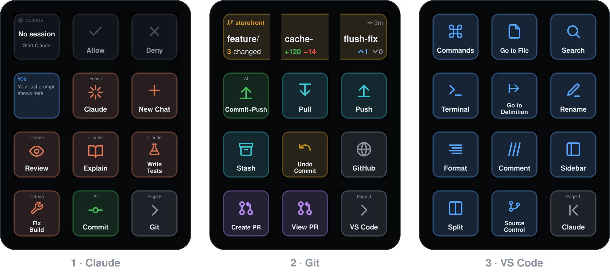
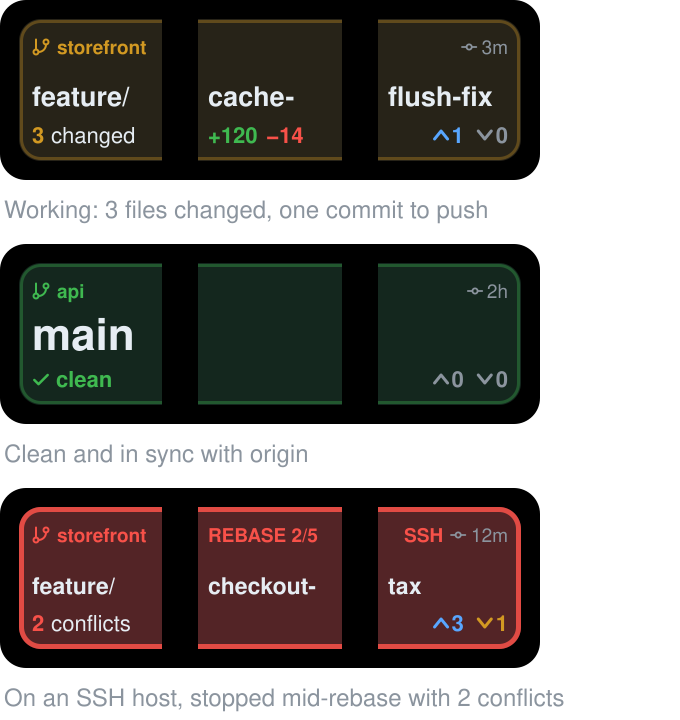

# Dev Deck

A developer profile for the Womier DUO87's Play Deck touch screen. It shows what Claude Code is doing and lets you answer its permission prompts with a tap. It also writes your git commits with Claude, puts your repo's status across a whole row of the screen, and gives you one-tap VS Code and git keys. Remote-SSH and GitHub Codespaces windows work too.

**[Open the interactive guide →](https://bryanlittlefield.github.io/dev-deck/)**



Unofficial: not affiliated with Womier or MiraBox.

## What you get

- **Live Claude Code status.** Working (with the tool it's running and a timer), Approve?, Question, Done or Error, across all your sessions. Tap it to jump to that session's VS Code window.
- **Answer Claude from the deck.** Allow and Deny light up when Claude asks for permission. While Claude works, Deny turns into Stop.
- **Saved prompts.** Review, Explain, Write Tests and Fix Build paste a prompt into Claude and send it.
- **Smart Commit.** It stages your changes, has Claude Haiku write a message in your repo's style, and lets you edit it before it commits, and pushes if you ask. It takes about 3 seconds.
- **A wide git display.** The Git page's top row is one display across three keys. It shows the repo, the full branch name, changed files, lines added and removed, commits ahead and behind, the last commit's age, and any merge or rebase in progress.
- **VS Code and git keys:** Command Palette, Go to File, Search, Terminal, Rename, Pull, Push, Stash, Undo Commit, Create PR, View PR and more.
- **Remote-SSH and Codespaces.** A small VS Code extension brings Claude sessions on remote machines to the deck.



## Install

You need:

- a Mac with the [DUO87 Play Deck app](https://www.womierkeyboard.com/pages/softwares)
- Node.js 18 or newer, with npm
- the Xcode Command Line Tools (`xcode-select --install`)
- VS Code with the Claude Code extension

The [Claude Code](https://claude.com/claude-code) CLI writes the commit messages. ImageMagick and the GitHub CLI (`gh`) are optional.

```sh
git clone https://github.com/bryanlittlefield/dev-deck.git ~/.duo87
~/.duo87/bin/duo87 install
```

Then turn on **Accessibility** for *DUO87_Play_Deck* (System Settings → Privacy & Security → Accessibility), so the keys can press shortcuts. Run `~/.duo87/bin/duo87 doctor` to check every piece.

Dev Deck has to live in `~/.duo87`, because the plugin, the Claude Code hook and the VS Code tasks look for it there. `install` backs up every file it changes to `~/.duo87/backups/` first. [Installing](docs/install.md) lists exactly what it touches.

To update: `git -C ~/.duo87 pull && ~/.duo87/bin/duo87 install`

## Docs

- [Interactive guide](https://bryanlittlefield.github.io/dev-deck/): the deck page by page on a preview of the screen, plus a step-by-step walkthrough
- [Installing](docs/install.md): requirements, what `install` changes, updating, uninstalling
- [Using the deck](docs/using.md): Claude status and approvals, prompts, Smart Commit, the git display
- [Keys](docs/keys.md): every key on every page
- [Customizing](docs/customizing.md): `layout.json`, the actions, wide displays, settings, adding shortcuts
- [Remote-SSH and Codespaces](docs/remote.md)
- [How it works](docs/how-it-works.md): the architecture, and what we learned about the Play Deck app and the DUO87 screen
- [Troubleshooting](docs/troubleshooting.md)

## What's in the repo

| Path | What it is |
|---|---|
| `bin/duo87` | The command-line tool: `install`, `build`, `doctor`, `status`, `guide`, and the remote kit commands |
| `bin/claude-status-hook.js` | Claude Code hook that records each session's state for the deck |
| `bin/git-info.js` | Git summary shared by the hook and the plugin |
| `bin/smart-commit` | Writes a commit message with Claude, then commits |
| `bin/duo87-node` | Finds a Node.js runtime on SSH hosts and codespaces |
| `plugin/com.duo87.devdeck.sdPlugin/` | The Play Deck plugin. `plugin/index.js` runs the keys; `plugin/render.js` draws them |
| `profile/layout.json` | The keys on each page, row by row |
| `vscode/` | Templates for the VS Code keybindings and tasks |
| `vscode-bridge/` | VS Code extension that brings remote Claude sessions to the deck |
| `remote-kit/` | Installer for SSH hosts and codespaces |
| `src/duo87-keys.swift` | Native helper that presses shortcuts and pastes prompts |
| `src/build-guide.js`, `src/guide-template.html` | Build the interactive guide and the key reference |
| `docs/` | The GitHub Pages site (`index.html`) and these docs |
| `config.example.json` | Every setting with its default; copy it to `config.json` to change one |

Runtime files live next to the sources and are git-ignored: `state/`, `logs/`, `backups/`, `build/` and your `config.json`.

After changing the layout or the renderer, run `~/.duo87/bin/duo87 guide` to rebuild `docs/index.html`, `docs/keys.md` and the images above.
