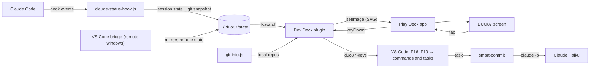

# How it works

This page is for anyone changing Dev Deck. It covers the architecture, and what we learned about the Play Deck app and the DUO87 screen along the way, since little of it is documented anywhere.



## The Play Deck app

*DUO87_Play_Deck* is a rebranded MiraBox StreamDock app (version 3.10, built on Qt 6.4). Its plugin system follows the Elgato Stream Deck SDK:

- A plugin is a folder with a `manifest.json`. It runs on the Node 20 the app bundles (`"Nodejs": { "Version": "20" }`).
- The plugin talks to the app over a local WebSocket. It receives `willAppear`, `willDisappear`, `keyDown`, `didReceiveSettings` and more, and sends `setImage`, `setTitle`, `showOk`, `showAlert` and `setSettings`.
- The settings panel is an HTML page, and the app calls its `connectElgatoStreamDeckSocket()`.

The app keeps its data in `~/Library/Application Support/HotSpot/StreamDock/`:

| Path | What |
|---|---|
| `plugins/` | Installed plugins |
| `profiles/<ID>.sdProfile/manifest.json` | A profile. Multi-page profiles keep each page in `profiles/<PAGE>.sdProfile/` and list the pages in `Pages` **with** the `.sdProfile` suffix; without it the app logs "Profile is not exists" |
| `config/StreamDockConfig.plist` | INI-style settings, including the active profile per device (`sdProfileName`, `sdProfilePath`) |
| `logs/` | App logs, useful for seeing which keys appear on a page change |

Keys in a profile are addressed as `"column,row"` on the grid the device reports.

## The screen is 3 wide, not 4

The app reports the DUO87 as a 4 × 3 grid (`size: { columns: 4, rows: 3 }`). The screen, though, is portrait: 320 × 480 pixels, with twelve 80 × 80 key images, **3 across and 4 down**. The app fills it in reading order, three keys per row. So screen row *y*, key *x* is the app's key number *y* × 3 + *x*, and its position in a profile is `(n % 4, ⌊n / 4⌋)`.

Two things show this:

- Womier's own *Keyboard* profile only makes sense this way. Read three per row, it's the navigation cluster the screen replaces: Insert, Home, PgUp over Delete, End, PgDn.
- An independent, reverse-engineered driver ([opendeck-duo87](https://github.com/MikaBust/opendeck-duo87)) uses 4 rows × 3 columns, with 80 × 80 JPEG keys rotated 180°.

`profile/layout.json` uses screen rows, and `bin/duo87` converts them (`appPos()`). `deck.screenColumns` in `config.json` changes the 3 if another screen ever needs it.

## Drawing keys

`plugin/render.js` draws every key as a 144 × 144 SVG and sends it as a data URL. The app rasterizes it with Qt SVG, which supports only a subset of SVG. The renderer therefore uses:

- no CSS, filters, masks or clip paths
- system fonts only
- paths for check marks and arrows, since glyphs like ✓ ↑ ↓ aren't reliable

Qt splits the `font-family` list, so text renders in Helvetica Neue. That lets the renderer measure text with Helvetica Neue's real advance widths (measured with CoreText and stored in `render.js`) instead of guessing character counts.

If a firmware or app version ever shows the keys blank, `deck.imageFormat: "png"` makes the plugin rasterize them itself first.

## The wide display

Several adjacent `banner` keys in one screen row are drawn as a single display:

1. On `willAppear` the app sends each key's `coordinates`. The plugin converts them to screen positions and groups adjacent banner keys in the same row.
2. It draws one SVG across the whole run: *count* × 144 units, plus a 36-unit gap between keys, matching the ~20 px between the screen's 80 px keys. Each key gets its own slice, shifted with `translate`, so the frame lines up across the gaps.
3. Text never crosses a gap. The branch is split into tokens after `/`, `-`, `_`, `.` and spaces, then packed into the keys. The renderer tries one line at sizes 44 down to 27, then two lines at 27 down to 22. Next it drops tokens from the middle (`…queue`). Only as a last resort does it break inside a word.
4. On a page switch, keys appear one at a time, so the plugin waits 80 ms before drawing a row, to avoid flicker. If the app ever stopped sending coordinates, the builder also bakes a `group` and `slot` into each banner key's settings as a fallback.

A lone banner key falls back to the one-key repo status.

## Pressing keys

`src/duo87-keys.swift` (compiled to `bin/duo87-keys`) posts keyboard events with CGEvent. The plugin passes it a list of steps:

- `activate` an app
- `wait`
- press a `key` combo
- `paste` text, which restores your clipboard afterwards and marks the pasted entry as transient
- `type` text
- `check` that Accessibility is on

macOS grants Accessibility to the process that runs it, the Play Deck app, so recompiling the helper doesn't need a new permission.

VS Code commands that have no default shortcut are bound to F16–F19 combos in the user `keybindings.json`. No physical key sends those, so they can't clash with anything. `runCommands` chains several commands on one combo. `claude-vscode.focus` attaches the editor selection to Claude's input. Answering a permission prompt means focusing Claude, then pressing <kbd>1</kbd>, <kbd>2</kbd> or <kbd>Esc</kbd>.

## Claude Code state

`bin/claude-status-hook.js` is registered as an async command hook for 11 events, so it never blocks Claude. It writes `~/.duo87/state/claude/<session>.json`. The files are created mode 600 and written atomically with a rename. An event that arrives out of order never overwrites newer state.

| Event | State |
|---|---|
| SessionStart | idle |
| UserPromptSubmit | working, with the prompt |
| PreToolUse, PostToolUse | working, with the tool and what it's doing |
| PermissionRequest, Notification (permission prompt) | permission, with what Claude wants to run |
| Notification (elicitation), AskUserQuestion | question |
| Stop | done, with the start of Claude's reply |
| StopFailure | error |
| SessionEnd | the file is removed |

Sessions that crash never send SessionEnd, so the plugin drops them after 2 hours of *working* or 12 hours otherwise.

## Git

`bin/git-info.js` is shared by the hook (synchronous, also on remotes) and the plugin (async). It runs:

- `git status --porcelain=v2 --branch --show-stash`: branch, upstream, ahead and behind, staged, unstaged, untracked and conflicted files, and stashes
- `git rev-parse --absolute-git-dir`: markers for a merge, rebase (with its step), cherry-pick, revert or bisect
- `git log -1`: the last commit
- `git diff HEAD --shortstat`: lines added and removed

Every command runs with `--no-optional-locks`, so polling never holds `index.lock` while you run git yourself. The plugin re-reads local repos every 4 seconds. For remote repos it uses the snapshot the hook takes after SessionStart, UserPromptSubmit, Stop, SubagentStop and file-changing tools. Smart Commit also refreshes that snapshot after it commits.

## Smart Commit

`bin/smart-commit` builds a compact context from the repo:

- the branch and the recent commit subjects
- changed files and the diffstat
- a patch truncated to `commit.maxDiffKB`, without lockfiles or minified files

It then runs Claude headless, with no tools, no MCP servers and no hooks:

```sh
claude -p --model haiku --tools "" --no-session-persistence --strict-mcp-config \
  --settings '{"disableAllHooks":true,"alwaysThinkingEnabled":false}'   # with MAX_THINKING_TOKENS=0
```

Leaving extended thinking on made it about four times slower. If Claude fails, a basic message is used instead. On the Mac you confirm in an `osascript` dialog. Over SSH, in Codespaces or in a container there's no screen to show it on, so it asks in the task's terminal. The result goes to `~/.duo87/state/commit.json`, which drives the Commit key.

## Remote windows

- **Where Claude runs:** the Claude Code extension doesn't declare an `extensionKind`, so in remote windows it runs on the remote, and so do its hooks.
- **The bridge:** `vscode-bridge/` is a UI extension (`"extensionKind": ["ui"]`), so it runs on the Mac and can read remote files through `vscode.workspace.fs` with `vscode-remote://` URIs. It finds the remote's `~/.duo87/state`, mirrors each session as `state/claude/r-<window>-<session>.json` (adding the remote's name and authority), and writes a heartbeat to `state/bridges/` every second. The plugin ignores mirrored sessions whose heartbeat is more than 15 seconds old.
- **Focusing a remote session:** tapping it runs `code --folder-uri vscode-remote://<authority><path>`, which brings that window forward.
- **Smart Commit remotely:** VS Code's *user* tasks also run in remote windows, with `${userHome}` pointing at the remote home. That's why the kit installs `smart-commit` and `duo87-node` at the same paths on every machine.

## Building the default images

The profile needs PNG images for its keys until the plugin draws them, and the page keys stay PNG. They're rendered with Quick Look (`qlmanage`). It draws an SVG about 4% smaller than the thumbnail, into its top-left corner, on white. The builder therefore renders at twice the size, trims the white, and scales down. The old crop left a white strip along two edges.

## What we didn't use

- **Full-screen backgrounds.** The app has an undocumented plugin event, `setBackground` (`{ event, device, payload: { image, clearIcon } }`), that draws one image across the whole screen. MiraBox's [device SDK](https://github.com/MiraboxSpace/StreamDock-Device-SDK) says this family of screens stores background images in the keyboard's flash, the way the screensaver's 320 × 480 images are stored. That's no place for data that changes every few seconds, so the wide display is drawn from ordinary key images instead.
- **`page.goto` numbering.** `PageIndex` is treated as 1-based, matching how the app numbers pages. The page keys wrap using it.
