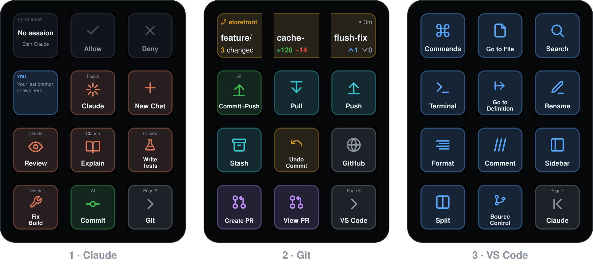

# Keys

<!-- Generated by src/build-guide.js from profile/layout.json. Run `~/.duo87/bin/duo87 guide` to refresh. -->

Every key on the Dev Deck, page by page. The screen is 3 keys wide and 4 tall; rows count from the top. The [interactive guide](https://bryanlittlefield.github.io/dev-deck/) shows the same keys on a preview of the screen.

## 1. Claude

| Key | Name | What it does | Sends |
|---|---|---|---|
| row 1, key 1 | Claude status | Live state of your Claude Code sessions: Ready, Working (with the tool it is running), Approve?, Question, Done or Error. A badge counts busy sessions. Tap to jump to that session’s VS Code window and focus the Claude input. | Reads ~/.duo87/state/claude (written by the hook) |
| row 1, key 2 | Allow | Blinks green while Claude waits for permission; tap to approve once. | 1 in the Claude panel |
| row 1, key 3 | Deny / Stop | Lights red while Claude waits for permission; tap to deny. While Claude is working it turns into Stop and interrupts it. | Esc in the Claude panel |
| row 2, key 1 | Your last prompt | Shows the last prompt you sent to Claude Code. Tap to copy the full text. | Copies to the clipboard |
| row 2, key 2 | Focus Claude | Brings VS Code forward and puts the cursor in the Claude input. Selected code is attached automatically. | ⌃⌥F16 → Claude Code: Focus input |
| row 2, key 3 | New Claude chat | Brings VS Code forward and starts a fresh Claude Code conversation. | ⌃⌥F17 → Claude Code: New conversation |
| row 3, key 1 | Prompt: Review | “Review my uncommitted changes (git diff HEAD) like a senior engineer: bugs, edge cases, security issues, and anything I forgot. Be concise and concrete, and don't change anything yet.” | Focuses Claude, pastes the prompt and presses ↩ |
| row 3, key 2 | Prompt: Explain | “Explain the selected code (or the file I have open): what it does, how it fits into the project, and any gotchas. Keep it short.” | Focuses Claude, pastes the prompt and presses ↩ |
| row 3, key 3 | Prompt: Write Tests | “Write or update tests for the code I'm working on, run them, and fix any failures. Follow the project's existing test conventions.” | Focuses Claude, pastes the prompt and presses ↩ |
| row 4, key 1 | Prompt: Fix Build | “Run this project's build, linter and tests. Fix whatever fails, then summarize what you changed.” | Focuses Claude, pastes the prompt and presses ↩ |
| row 4, key 2 | Smart Commit | Stages everything if nothing is staged, has Claude Haiku write the message in your repo’s style, and shows it for editing before committing. | ⌃⌥F18 → task “DUO87: Smart Commit” |
| row 4, key 3 | Go to Git | Switches the screen to page 2, Git. | Built-in page action |

## 2. Git

| Key | Name | What it does | Sends |
|---|---|---|---|
| row 1, key 1 | Git display (left) | One display across the whole row: repo, the full branch name, changed files, lines added/removed, commits ahead/behind, the last commit’s age, and any merge, rebase or conflicts in progress. It follows the repo of the Claude session you prompted most recently, SSH and Codespaces included. Tap this part to switch branch. | ⌘⌥F17 → Git: Checkout to… |
| row 1, key 2 | Git display (middle) | One display across the whole row: repo, the full branch name, changed files, lines added/removed, commits ahead/behind, the last commit’s age, and any merge, rebase or conflicts in progress. It follows the repo of the Claude session you prompted most recently, SSH and Codespaces included. Tap this part to open Source Control. | ⌃⇧G → Source Control |
| row 1, key 3 | Git display (right) | One display across the whole row: repo, the full branch name, changed files, lines added/removed, commits ahead/behind, the last commit’s age, and any merge, rebase or conflicts in progress. It follows the repo of the Claude session you prompted most recently, SSH and Codespaces included. Tap this part to open Source Control. | ⌃⇧G → Source Control |
| row 2, key 1 | Smart Commit + Push | Same as Commit, then pushes (sets the upstream on a branch’s first push). | ⌃⌥F19 → task “DUO87: Smart Commit + Push” |
| row 2, key 2 | Pull | Git: Pull. | ⌃⇧F17 to VS Code |
| row 2, key 3 | Push | Git: Push. | ⌃⇧F18 to VS Code |
| row 3, key 1 | Stash | Git: Stash. | ⌥⇧F19 to VS Code |
| row 3, key 2 | Undo Commit | Git: Undo Last Commit. | ⌘⌥F16 to VS Code |
| row 3, key 3 | GitHub | Run task “DUO87: Open on GitHub” (gh browse). | ⌥⇧F18 to VS Code |
| row 4, key 1 | Create PR | Run task “DUO87: Create PR” (gh pr create --web). | ⌥⇧F16 to VS Code |
| row 4, key 2 | View PR | Run task “DUO87: View PR” (gh pr view --web). | ⌥⇧F17 to VS Code |
| row 4, key 3 | Go to VS Code | Switches the screen to page 3, VS Code. | Built-in page action |

## 3. VS Code

| Key | Name | What it does | Sends |
|---|---|---|---|
| row 1, key 1 | Commands | Command Palette. | ⌘⇧P to VS Code |
| row 1, key 2 | Go to File | Quick Open (go to file). | ⌘P to VS Code |
| row 1, key 3 | Search | Search across files. | ⌘⇧F to VS Code |
| row 2, key 1 | Terminal | Toggle the terminal panel. | ⌃` to VS Code |
| row 2, key 2 | Go to Definition | Go to Definition. | F12 to VS Code |
| row 2, key 3 | Rename | Rename Symbol. | F2 to VS Code |
| row 3, key 1 | Format | Format Document. | ⇧⌥F to VS Code |
| row 3, key 2 | Comment | Toggle line comment. | ⌘/ to VS Code |
| row 3, key 3 | Sidebar | Toggle the primary sidebar. | ⌘B to VS Code |
| row 4, key 1 | Split | Split the editor. | ⌘\ to VS Code |
| row 4, key 2 | Source Control | Open Source Control. | ⌃⇧G to VS Code |
| row 4, key 3 | Go to Claude | Switches the screen to page 1, Claude (back to the start). | Built-in page action |

## F16–F19 bindings

These live in VS Code's user `keybindings.json` (template: [`vscode/keybindings.json`](../vscode/keybindings.json)). No physical key sends F16–F19, so they can't collide with anything.

| Keys | keybindings.json | Runs |
|---|---|---|
| ⌃⌥F16 | `ctrl+alt+f16` | Claude Code: Focus input |
| ⌃⌥F17 | `ctrl+alt+f17` | Claude Code: New conversation |
| ⌃⌥F18 | `ctrl+alt+f18` | Run task “DUO87: Smart Commit” |
| ⌃⌥F19 | `ctrl+alt+f19` | Run task “DUO87: Smart Commit + Push” |
| ⌃⇧F16 | `ctrl+shift+f16` | Terminal: Focus (for Claude running in the VS Code terminal) |
| ⌃⇧F17 | `ctrl+shift+f17` | Git: Pull |
| ⌃⇧F18 | `ctrl+shift+f18` | Git: Push |
| ⌃⇧F19 | `ctrl+shift+f19` | Git: Sync |
| ⌥⇧F16 | `alt+shift+f16` | Run task “DUO87: Create PR” (gh pr create --web) |
| ⌥⇧F17 | `alt+shift+f17` | Run task “DUO87: View PR” (gh pr view --web) |
| ⌥⇧F18 | `alt+shift+f18` | Run task “DUO87: Open on GitHub” (gh browse) |
| ⌥⇧F19 | `alt+shift+f19` | Git: Stash |
| ⌘⌥F16 | `cmd+alt+f16` | Git: Undo Last Commit |
| ⌘⌥F17 | `cmd+alt+f17` | Git: Checkout to… (switch branch) |
| ⌘⌥F18 | `cmd+alt+f18` | Claude Code: Accept Proposed Changes |
| ⌘⌥F19 | `cmd+alt+f19` | Claude Code: Reject Proposed Changes |
