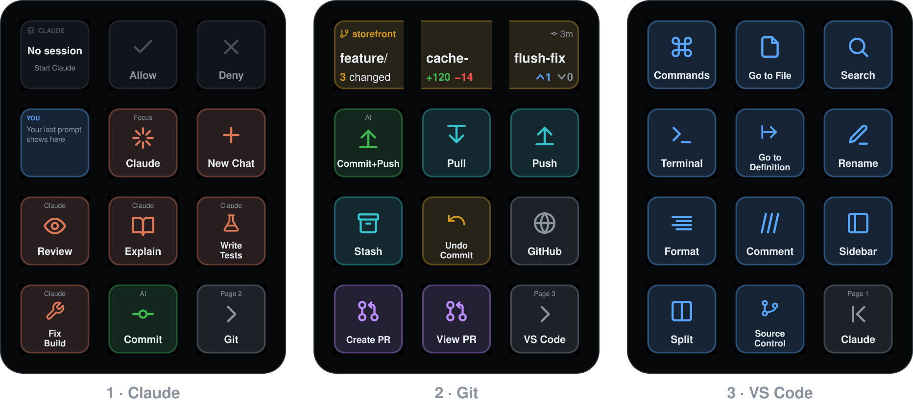
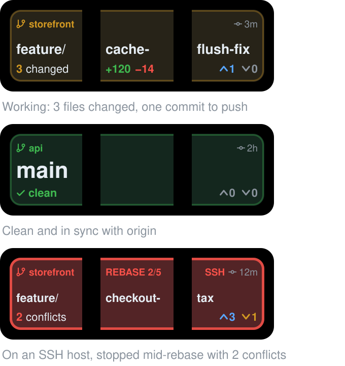

# Using the deck

The DUO87 screen is 3 keys wide and 4 tall. Dev Deck gives it three pages: **Claude**, **Git** and **VS Code**. The bottom-right key goes to the next page, and on the last page it goes back to the first. [Keys](keys.md) lists every key, and the [interactive guide](https://bryanlittlefield.github.io/dev-deck/) shows them on a preview of the screen.

Keys that press shortcuts bring VS Code forward first, so they work even when another app has focus.



## Claude Code

The Claude page is built around Claude Code in the VS Code sidebar. The top row is Claude's status with Allow and Deny beside it. The second row is your last prompt, Focus and New Chat. The bottom two rows hold saved prompts, Smart Commit and the page key.

**Status** (top-left) updates live from every Claude Code session on your Mac, and from SSH hosts and codespaces that have the [remote kit](remote.md):

| It shows | Meaning |
|---|---|
| Ready | A session is open and idle |
| Working | Claude is running; the key names the tool (e.g. `Bash · Run tests`) and shows a timer |
| Approve? (amber, blinking) | Claude is waiting for your permission; the key shows what it wants to run |
| Question | Claude asked you something |
| Done (green) | Claude finished; it's your turn |
| Error (red) | The turn failed (for example a rate limit) |

A number badge means several sessions are busy. The heading says `SSH`, `CODESPACE` or `CONTAINER` for a remote session. Tap the key to jump to that session's VS Code window, with the cursor in Claude's input.

**Allow and Deny** stay dim until Claude asks for permission. Allow presses <kbd>1</kbd> in the Claude panel (approve once) and Deny presses <kbd>Esc</kbd>. While Claude is working, Deny becomes **Stop** and interrupts it. An *Always* variant, which presses <kbd>2</kbd> (don't ask again), is available in the key's settings.

**Your last prompt** shows the start of the last thing you asked Claude. Tap it to copy the full text. Set *Show* to *Claude's last reply* to make it show Claude's answer instead.

**Focus** puts the cursor in Claude's input. **New Chat** starts a fresh conversation. Code you've selected in the editor is attached automatically.

**Prompt keys** (Review, Explain, Write Tests, Fix Build) focus Claude, paste a saved prompt and press Enter. Select code first and it's sent as context. You can add your own, including slash commands like `/compact` (see [Customizing](customizing.md)).

## Smart Commit

Tap **Commit** on the Claude page, or **Commit+Push** on the Git page:

1. VS Code runs the *DUO87: Smart Commit* task in the current window's workspace, and the key shows *Writing…*.
2. If nothing is staged, everything is staged (`git add -A`). If you staged some files yourself, only those are committed.
3. Claude Haiku writes a message that matches your recent commits: Conventional Commits if the repo uses them, ticket IDs taken from the branch name, and a short body only when the change needs one. It takes about 2–4 seconds and runs with no tools and no extended thinking. Your other Claude Code hooks stay quiet.
4. You review the message. On your Mac a dialog offers *Commit*, *Commit & Push* and *Cancel*. In a remote window you answer in the task terminal (Enter, `p`, `e`, `n`). You can edit the message either way. Cancel un-stages whatever Smart Commit staged.
5. The key shows the new short hash for two minutes. Commits get `Signed-off-by`, and are signed however your git config signs commits.

It works from any terminal too:

```sh
~/.duo87/bin/smart-commit                  # current repo, with the dialog
~/.duo87/bin/smart-commit --dry-run        # print the message only
~/.duo87/bin/smart-commit ~/code/app --push --yes
```

Settings (model, dialog, sign-off, trailer, notifications) are under `commit` in `~/.duo87/config.json`. See [Customizing](customizing.md#settings).

## The git display

The Git page's top row is one display across all three keys, so nothing is squeezed into a single tile.



- **Top line:** the repo (with `SSH` or `CODESPACE` when it's remote), a warning slot, and how long ago you last committed.
- **Middle:** the whole branch name, as large as it fits. It breaks after `/`, `-`, `_` or `.` so no word is split by the gaps between keys. Very long names lose words from the middle.
- **Bottom line:** changed files (or a green *clean*), lines added and removed, and commits ahead of (`^`) and behind (`v`) the remote. The bottom-right reads *not pushed* when the branch has no upstream.
- **Warnings:** merges, rebases (with their step, e.g. `REBASE 2/5`), cherry-picks, reverts, bisects, conflicts, a detached HEAD, staged files, and stashes. The strip's color sums it up: red during a merge or rebase or with conflicts, amber with uncommitted changes, blue when you're ahead of or behind the remote, green when it's clean and in sync.

**Tapping:** the left key switches branch, and the other two open Source Control. Nothing on the display pushes. That's deliberate: VS Code's Sync pushes without asking when `git.confirmSync` is off. Push and Commit+Push are the keys right below it. To change what one part does, select it in the app and pick *Tap*.

**Which repo it shows:** the repo of the Claude session you prompted most recently. Sessions outside a git repo are skipped, so a Claude chat in your home folder won't take it over. Remote sessions count too. To pin one repo, set *Repo path* on the display's left key.

**How fresh it is:** local repos are re-read every few seconds. It runs git with optional locks off, so it never holds `index.lock` while you work. Remote repos update after each Claude step and each Smart Commit.

## Git and VS Code keys

The Git page has Commit+Push, Pull, Push, Stash, Undo Commit, GitHub (opens the repo), Create PR and View PR. The PR and GitHub keys use `gh`. The VS Code page has Command Palette, Go to File, Search, Terminal, Go to Definition, Rename, Format, Comment, Sidebar, Split and Source Control.

Commands without a default shortcut are bound to F16–F19 combos in VS Code's `keybindings.json`; [Keys](keys.md#f16f19-bindings) has the list. To add your own, see [Customizing](customizing.md#adding-a-vs-code-command).
